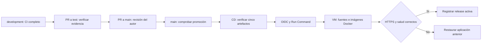

# Despliegue continuo en Azure

El workflow [CD Azure](../.github/workflows/cd.yml) actualiza la VM mediante Docker después de que el CI de `main` termine correctamente. La integración en main sigue requiriendo la revisión del autor; CD no añade una aprobación manual posterior ni despliega development/test. La [issue #101](https://github.com/ngarayc/Nexo/issues/101) identifica este incremento.



## Qué autoriza un despliegue

El disparador automático acepta únicamente la finalización satisfactoria de `CI`, por push a main del repositorio propio. El modo manual de Actions vuelve a desplegar el main actual; no permite elegir otra rama o SHA. Un candidato superado por otro main no se despliega.

Un primer job sin identidad Azure verifica la candidatura; solo entonces se crea el despliegue del environment. El segundo job vuelve a confirmar que main siga vigente antes del login. Antes de autenticar en Azure se comprueban el checkout exacto, la PR integrada, el CI de main, su manifiesto de promoción y los cinco artefactos originales de development. Se verifican árbol Git, ejecución/intento, nombres, contenido, digests e inventario de jobs. CD reutiliza esa evidencia; no ejecuta de nuevo suites por cambiar de rama. Un verde ajeno, una ejecución incompleta o una evidencia caducada no habilitan publicación. Si caduca la evidencia, renovar CI y el manifiesto antes de volver a desplegar.

## Identidad y configuración única

Azure usa una identidad administrada asignada por el usuario, con credencial federada para el issuer `https://token.actions.githubusercontent.com` y audience `api://AzureADTokenExchange`. El subject debe coincidir exactamente con el prefijo que devuelve `GET /repos/{owner}/{repo}/actions/oidc/customization/sub`, seguido de `:environment:azure-demo`. El prefijo inmutable incluye los identificadores de repositorio/propietario; no asumir el formato antiguo basado solo en nombres.

El environment `azure-demo` admite únicamente la rama main. Sus variables son `AZURE_CLIENT_ID`, `AZURE_TENANT_ID`, `AZURE_SUBSCRIPTION_ID`, `AZURE_RESOURCE_GROUP`, `AZURE_VM_NAME` y `NEXO_PUBLIC_ORIGIN`. Son identificadores/configuración, no contraseñas. No se almacenan claves SSH ni secretos Azure duraderos en GitHub. El origen debe coincidir con el entorno privado de la VM.

La identidad tiene un rol propio asignado exclusivamente sobre la VM de Nexo. Sus acciones se limitan a lectura de VM y ejecución/lectura de Run Command; no puede asignar roles, borrar recursos ni administrar la suscripción. Run Command ejecuta el operador como root dentro de esa VM: el código de main y su revisión constituyen la frontera de administración del host. El workflow usa acciones fijadas por SHA y token de repositorio con lectura de contenido, Actions y PR. La lectura de PR permite acreditar la integración que introdujo el SHA; solo el job de despliegue obtiene `id-token: write` para OIDC.

La VM debe estar provisionada con Docker/Compose, Python 3.12, curl, agente Azure, el disco persistente y `/opt/nexo-private/.env.azure` root600. El despliegue inicial se describe en [el perfil cloud](cloud-deployment.md). CD valida el proyecto/volumen y rechaza un disco no montado o una configuración diferente; no crea una base nueva ni adopta otro volumen.

## Fuentes, imágenes y activación

El [operador de VM](../scripts/cd/azure-vm.py) descarga el archivo público del SHA inmutable y lo contrasta con un manifiesto del checkout aprobado. El manifiesto cubre contenido, rutas, permisos ejecutables y enlaces; se rechazan rutas/enlaces que escapen de la raíz. Las fuentes verificadas se guardan en `/opt/nexo-releases/<sha>`.

La VM reconstruye las cuatro imágenes con bases por digest, lockfiles y parches fijados; CI acredita el mismo árbol fuente, no la identidad binaria de esta reconstrucción. Cada imagen de destino se escanea de nuevo con Trivy verificado por checksum y una base de avisos recién descargada. Se reutiliza el validador de imágenes de CI para exigir inventarios Alpine/Node/Go, cero HIGH/CRITICAL y ausencia de resultados inconclusos. Las imágenes tienen etiquetas de release y `org.opencontainers.image.revision`; se registran sus IDs reales.

La release anterior permanece funcionando durante descarga, build y escaneo. Se confirma otra vez el SHA actual de main al terminar la construcción. Solo después se detienen los servicios y se activa el candidato con Compose, sin borrar volúmenes ni descargar sustitutos de sus etiquetas. Se comprueban los cuatro IDs, `/api/health` mediante HTTPS con certificado válido y la página principal. Cuenta, contraseña, certificados y datos permanecen; el arranque no envía fixtures o reproducciones. CD no genera respaldos de datos ni ejecuta la limpieza demo.

Un fallo al detener o activar restaura imágenes y proxy de la aplicación anterior y vuelve a comprobar su salud. La reversión no deshace migraciones ni datos: los cambios de esquema deben ser compatibles con la versión anterior. Un rollback mantiene la ejecución CD fallida; no se presenta como despliegue satisfactorio del candidato. Un timeout o una respuesta ausente de Azure no se repiten automáticamente: comprobar primero el estado persistido de la VM.

## Reinicios, operación y evidencia

Un archivo privado y atómico, `/opt/nexo-private/active-release.json`, identifica la última release saludable y sus imágenes. El [servicio systemd](../infra/nexo-compose.service) arranca esa release tras Docker y el montaje del disco. Un reinicio durante la construcción conserva la release anterior. El enlace `/opt/nexo` permite consultar las fuentes activas; la autoridad del arranque es el registro privado.

Después de activar CD, administrar con systemd o con el operador instalado:

```sh
sudo python3 /usr/local/lib/nexo-deploy.py boot status
sudo systemctl start nexo-compose
sudo python3 /usr/local/lib/nexo-deploy.py boot up
```

Los despliegues se serializan en Actions y mediante un bloqueo de VM. No ejecutar operaciones Compose manuales mientras CD esté activo. Una repetición del mismo SHA ya saludable comprueba estado y devuelve `already_current`, sin reconstruir ni reiniciar los servicios.

Actions publica en su resumen el SHA confirmado y mantiene el estado del environment. Los inventarios, configuración privada, salida Azure y logs permanecen fuera de los artefactos públicos. El agente VM debe devolver un marcador inequívoco con SHA, salud y las cuatro imágenes: HTTP200 de Azure por sí solo no acredita el despliegue. El registro privado conserva la release anterior para recuperación.

Las pruebas de [política](../scripts/ci/cd-policy.test.mjs) y [operador](../tests/cd/test_azure_vm.py) cubren ramas/eventos ajenos, identidad y CI incompletos, workflow inseguro, falso éxito Azure, manifiestos alterados, rutas/enlaces externos y rollback ante fallo parcial. La primera ejecución real de OIDC/CD se verifica después de integrar este incremento en main; las pruebas simuladas no sustituyen esa ejecución.

Referencias: [OIDC de GitHub](https://docs.github.com/en/actions/reference/security/oidc), [Azure Login con identidad federada](https://learn.microsoft.com/en-us/azure/developer/github/connect-from-azure-openid-connect), [Run Command y sus límites](https://learn.microsoft.com/en-us/azure/virtual-machines/linux/run-command).
