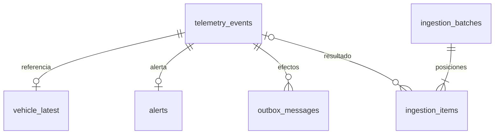

# Persistencia exacta — E1-I01

La migración `0001_ingestion_foundation.sql` añade seis tablas a `users`, sin modificar la migración publicada de E0. Los adaptadores puros de `modules/telemetry/domain/` conservan identidad, instante y JSON. La recepción HTTP, la clasificación transaccional, pg-boss y el despacho SSE se incorporan en los siguientes incrementos; estas tablas todavía no los ejecutan.

## Relaciones y garantías

| Tabla               | Responsabilidad y garantía actual                                                                                                            |
| ------------------- | -------------------------------------------------------------------------------------------------------------------------------------------- |
| `telemetry_events`  | Evento aceptado inmutable; identidad global exacta, coordenadas y velocidad finitas con rangos; instante original y representación ordenable |
| `vehicle_latest`    | Una referencia por vehículo; FK y trigger comprueban que el evento pertenece al mismo vehículo; identidad inmutable                          |
| `alerts`            | Como máximo una `OVERSPEED` por evento, sin duplicar sus datos                                                                               |
| `ingestion_batches` | Documento admitido, tamaño lógico, cursor y revisión; estados active/complete/failed coherentes; evidencia y resultado final inmutables      |
| `ingestion_items`   | Entrada por posición, clasificación o fallo técnico, generación, job y presupuesto; una sola posición scheduled por lote                     |
| `outbox_messages`   | Efecto único por evento/tipo; payload, versión y tamaño de trama inmutables; publicación y diagnóstico actualizables                         |

Un input inválido puede ser `null`, primitivo o un objeto sin ID; su JSON no exige FK a un evento. Solo accepted/duplicate tienen referencia resuelta. Los estados failed/blocked no suman rejected. Cada posición conserva `attempt_limit` y `policy_version` inmutables, además de la generación y fecha del último fallo; reprogramar no reinicia el presupuesto. Los CHECK excluyen expresamente combinaciones con outcome nulo que SQL podría admitir por su lógica de tres valores.

La base no decide por sí sola qué evento es el último, si el payload repetido es igual, cuándo crear una alerta por velocidad >80 ni cómo avanzar el lote atómicamente. Esas reglas corresponden a los casos de uso posteriores. Tampoco se deduce el orden de observación o confirmación de una PK interna.

## Identidad completa y colisiones

Los IDs públicos siguen siendo strings no vacíos. `identity.ts` los representa internamente como unidades de cuatro bytes big endian por punto de código; conserva también sustitutos aislados, nulo escapado, mayúsculas y espacios. SQL y TypeScript rechazan representaciones no canónicas. El orden binario coincide con el comparador por puntos de código, sin depender del locale ni del orden UTF-16.

Las PK de relación son bigint. La identidad se protege mediante `EXCLUDE USING hash (... WITH =) NOT DEFERRABLE`: el índice selecciona candidatos y PostgreSQL comprueba igualdad del valor completo. Un hash coincidente no equivale a un ID coincidente. El historial dispone de otro índice hash por vehículo; su orden exige `ORDER BY` explícito.

Se evita un B-tree sobre IDs sin cota contractual porque sus entradas tienen un tamaño limitado. El coste es conservar una representación más grande, verificar candidatos y ordenar aparte los historiales. No se promete rendimiento de flota productiva. Las pruebas incluyen un ID de 100 000 caracteres, una colisión real de `hashbytea` con dos valores distintos y dos conexiones compitiendo por el mismo ID. Tras `ON CONFLICT ON CONSTRAINT ... DO NOTHING`, una nueva sentencia en READ COMMITTED lee al ganador; no se usa DO UPDATE con la exclusión.

Fuentes: [exclusiones](https://www.postgresql.org/docs/18/ddl-constraints.html#DDL-CONSTRAINTS-EXCLUSION), [índices hash](https://www.postgresql.org/docs/18/hash-index.html), [límite B-tree](https://www.postgresql.org/docs/18/btree.html) y [visibilidad en READ COMMITTED](https://www.postgresql.org/docs/18/transaction-iso.html). La codificación reversible es una adaptación propia de Nexo.

## Tiempo y JSON sin redondeo silencioso

`observed-instant.ts` usa [Temporal](https://github.com/js-temporal/temporal-polyfill) para validar calendario/zona y obtener el segundo UTC. Conserva aparte los decimales posteriores al nanosegundo y elimina solo ceros finales. La base guarda original, segundo bigint y fracción canónica con collation C. El orden es segundo, fracción e ID; los instantes anteriores a 1970 se descomponen con piso, conservando fracción positiva. Las fechas técnicas usan timestamptz y no establecen el orden observado. La biblioteca no acredita todas las variantes posibles de ISO 8601; las formas admitidas se verifican mediante los casos del adaptador.

`OriginalJson` utiliza el árbol y offsets de [jsonc-parser](https://github.com/microsoft/node-jsonc-parser), rechazando cualquier error, comentario o coma final. No repara entradas. El documento completo conserva sus espacios externos; las posiciones y extras se extraen de los fragmentos originales. La igualdad ignora espacios y orden de propiedades, mantiene orden de arrays, tipos y diferencia entre ausencia/null. Las claves repetidas usan su última aparición y `__proto__` permanece como dato. Los números de extras se comparan mediante coeficiente y exponente bigint, sin redondearlos a Number ni expandir potencias enormes. Los campos numéricos conocidos conservan la validación finita de dominio.

Las columnas usan [json de PostgreSQL](https://www.postgresql.org/docs/18/datatype-json.html) para conservar texto, escapes y números originales. El driver pg interpreta JSON por defecto: **los lectores deben seleccionar `columna::text`**, y las inserciones devolver solo las claves necesarias. El tipo Drizzle falla explícitamente ante una lectura implícita que perdería precisión. No se usa jsonb ni se reconstruye la evidencia con JSON.parse/JSON.stringify. El coste es almacenamiento y análisis de texto, sin índice GIN para estos documentos.

## Migraciones y permisos

`schema.ts` y sus snapshots describen las tablas, FK, CHECK e índices representables por Drizzle. La misma migración incluye explícitamente la función de identidad, dos exclusiones y cinco triggers. No deben borrarse al generar otro cambio. `npm run schema:check`, incluido en quality, ejecuta el generador sobre una copia temporal, exige su mensaje positivo y comprueba que no cambió ningún archivo. Una salida cero del CLI sin esa evidencia falla el control. Los tests PostgreSQL verifican además el catálogo real y el comportamiento del SQL manual; el chequeo del generador no los sustituye.

La revisión bigint usa `default(sql\`0\`)`: Kit 0.31.11 no serializa `default(0n)` en el snapshot y puede devolver cero tras ese fallo. Se comprobó el rechazo del control frente a ese defecto y su recuperación al restaurar la definición. Las migraciones ya publicadas se conservan; cualquier cambio posterior añade una nueva.

`nexo_owner` prepara el esquema antes de servir. `nexo_app` lee/añade las seis tablas, cambia solo `event_pk` en la proyección y solo metadatos de publicación en outbox. No modifica/elimina eventos, usuarios, IDs o payloads; carece de DDL y tablas temporales. Los triggers se ejecutan con permisos del invocador. La FK y la inmutabilidad del evento permiten comprobar su vehículo con SELECT sin conceder UPDATE para un bloqueo explícito adicional.

## Verificación reproducible y límites

Construir las imágenes y ejecutar `npm run test:unit` y `npm run test:integration` según [operación](operations.md). `tests/integration/persistence.test.mjs` usa la API compilada, Drizzle y PostgreSQL reales en un proyecto sintético propio. Comprueba catálogo, restricciones, Unicode, colisiones, concurrencia, precisión, JSON, privilegios, upgrade desde la migración E0 y repetición conservando cuenta/hash. También compara las seis tablas antes/después de recrear API y PostgreSQL con su volumen. Los valores sensibles se comparan en memoria.

Estas pruebas escriben fixtures mediante adaptadores y SQL. No demuestran aún admisión HTTP, transacción de clasificación, reintentos de cola, resultados 20/2/2 o SSE; [verificación](verification.md) mantiene sus resultados y pendientes separados.
